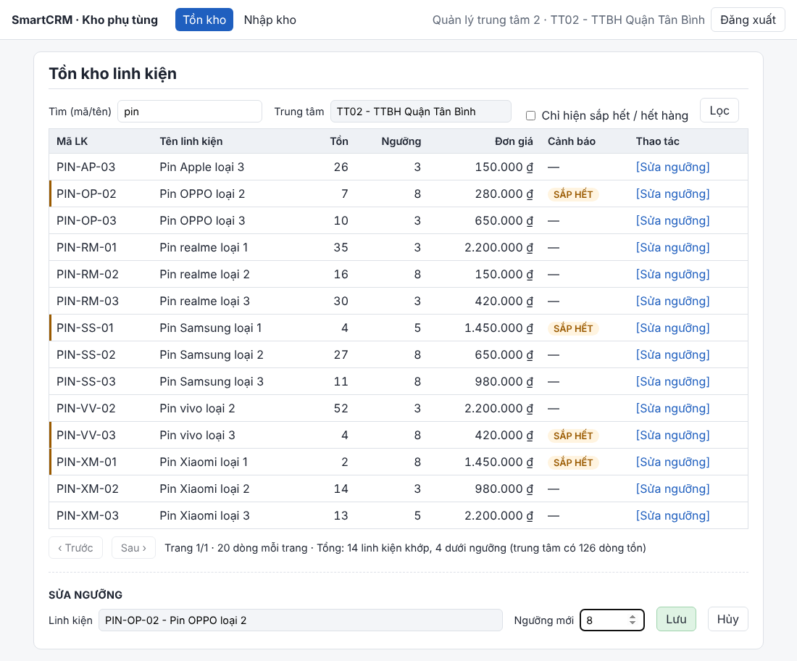
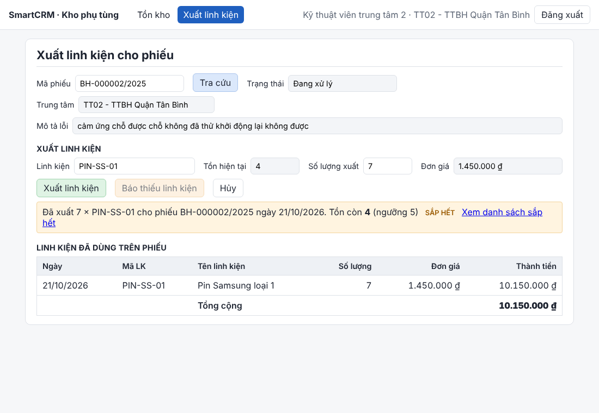
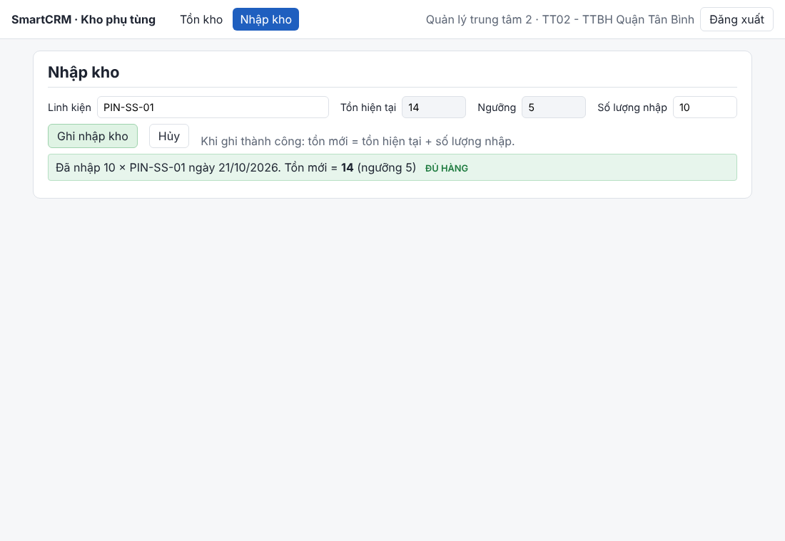
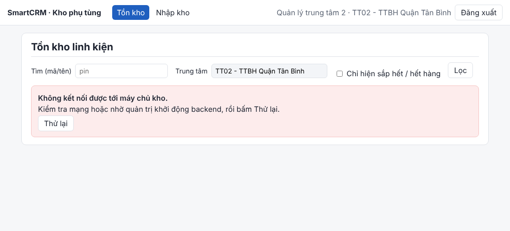
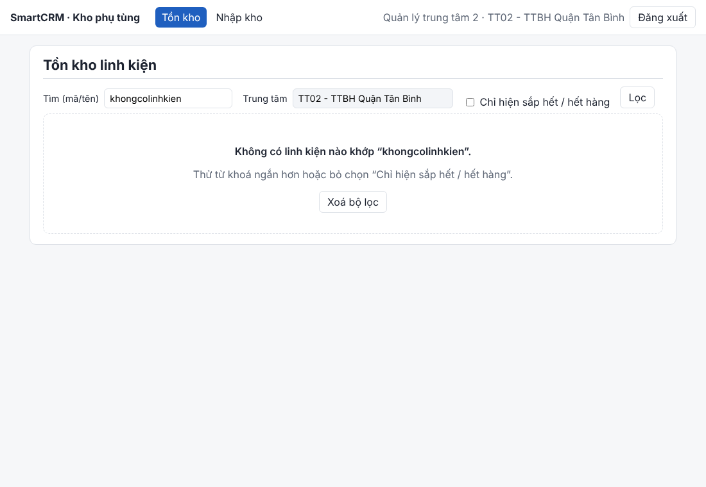

# SmartCRM – Hệ thống quản lý kho phụ tùng

## 1. Giới thiệu dự án

SmartCRM là dự án phục vụ việc quản lý kho phụ tùng thay thế cho trung tâm bảo hành (luồng L5 của hệ thống Smart CRM – Mekong Mobile). Phạm vi nghiệp vụ tập trung vào việc tra cứu tồn kho, xuất kho cho phiếu bảo hành, nhập kho và cảnh báo tồn thấp.

Tài liệu phân tích và thiết kế nằm trong thư mục `docs/`, gồm đặc tả yêu cầu, sơ đồ Use Case, sơ đồ kiến trúc, sơ đồ ERD, wireframe, hợp đồng API và nhật ký thay đổi thiết kế.

## 2. Yêu cầu môi trường

Chạy bằng Docker (mục 3.1) chỉ cần **Docker Desktop** (hoặc Docker Engine) có **Docker Compose v2** (lệnh `docker compose`, kiểm tra bằng `docker compose version`). Không cần cài Node hay PostgreSQL; phiên bản được ghim trong ảnh: Node.js 22 (`node:22-alpine`), PostgreSQL 16 (`postgres:16-alpine`), nginx 1.27.

Chạy trực tiếp bằng Node (mục 3.2) cần:

- Node.js 22 LTS (tối thiểu 20; Node 20 đã hết hạn hỗ trợ từ 04/2026), npm 10 trở lên (kiểm tra bằng `node -v` và `npm -v`)
- PostgreSQL 16 (hoặc 14 trở lên), đã tạo CSDL tên `smartcrm`
- Thư viện backend (cài đúng phiên bản trong `package-lock.json` bằng `npm ci`): `express`, `pg`, `dotenv`, `csv-parse`, `zod` (kiểm tra đầu vào), `jsonwebtoken` (đọc token)
- Thư viện frontend (cài bằng `npm ci` trong `src/frontend`): `react`, `react-dom`, `vite`
- Biến môi trường: mọi biến có trong `.env.example` kèm giá trị mẫu và chú thích (`DB_*`, `APP_PORT`, `SECRET_KEY`, `CORS_ORIGIN`, `DEMO_PASSWORD`, `LOG_LEVEL`, `DB_CONNECT_TIMEOUT_MS`, `LOCAL_DATA_DIR`, `DATA_DIR`, `WEB_PORT`, `TEST_DB_NAME`...) và `src/frontend/.env.example` (`VITE_API_BASE_URL`)
- Dữ liệu: repo có sẵn dữ liệu mẫu nhỏ trong `data-mau/` (xem `data-mau/README.md`), Docker tự nạp thư mục này. Dataset đầy đủ lấy từ `CDTN1_Mekong Mobile_Dataset Smart CRM.zip`, đặt trong thư mục `data/` ở gốc repo (không commit): bắt buộc `service_centers.csv`, `parts.csv`, `part_stock.csv`; thêm `tickets_history.csv` và `part_transactions.csv` để có phiếu cho chức năng xuất kho
- Hệ điều hành đã chạy thử: Windows, terminal PowerShell (gọi API bằng `curl.exe`); bản Docker đã chạy thử trên Linux (Docker 29, Compose v2)

## 3. Chạy hệ thống

Có hai cách. Cách 1 (Docker) chỉ cần hai lệnh và không phải cài gì ngoài Docker; cách 2 chạy trực tiếp bằng Node trên máy.

### 3.1. Cách 1: Docker, hai lệnh (khuyến nghị)

Mở terminal tại thư mục gốc repo vừa clone:

```bash
cp .env.example .env          # Windows PowerShell: Copy-Item .env.example .env
docker compose up -d --build
```

Lần đầu mất vài phút để tải ảnh và dựng. Compose chạy ba dịch vụ theo thứ tự: `db` (PostgreSQL) → `api` (backend, chờ `db` healthy, tự chờ CSDL, tạo bảng, nạp dữ liệu mẫu `data-mau/`) → `web` (giao diện, chờ `api` healthy).

**Kiểm tra hệ thống đã lên**

```bash
docker compose ps                     # cột STATUS của db, api, web phải là "healthy", không chỉ "running"
curl http://localhost:3000/health     # {"status":"ok","db":"ok"}   (PowerShell: curl.exe)
docker compose logs api --tail 20     # log dạng JSON, mỗi yêu cầu có requestId
```

Mở `http://localhost:8080` và đăng nhập `ktv2` hoặc `quanly2`, mật khẩu là `DEMO_PASSWORD` trong `.env` (mặc định `matkhau-demo-2026`). Dữ liệu mẫu có đủ 6 trung tâm, 180 linh kiện, 717 dòng tồn, 360 phiếu (có `BH-000002/2025` để thử xuất kho).

**Các lệnh hay dùng**

| Lệnh | Dùng khi |
|---|---|
| `docker compose logs -f api` | Xem log backend; bước đầu tiên khi có lỗi |
| `docker compose down` | Tắt hệ thống, giữ dữ liệu |
| `docker compose down -v` | Tắt và xoá dữ liệu CSDL; lần `up` sau nạp lại từ đầu |
| `docker compose exec db sh -c 'psql -U "$POSTGRES_USER" -d "$POSTGRES_DB"'` | Mở psql trong container CSDL |

**Dùng dataset đầy đủ thay cho dữ liệu mẫu:** chép 5 file CSV vào `data/`, sửa `.env` thành `LOCAL_DATA_DIR=./data`, rồi chạy `docker compose down -v` và `docker compose up -d --build`.

**Cổng bị chiếm** (`port is already allocated`): đổi `APP_PORT` (mặc định 3000), `WEB_PORT` (8080) hoặc `DB_PUBLISH_PORT` (5433) trong `.env` rồi `up` lại. CSDL trong Docker mở ra cổng 5433 để không đụng PostgreSQL cài sẵn trên máy (5432).

**Thử suy giảm có kiểm soát:** `docker compose stop db` thì API vẫn chạy và trả 503 kèm mã tra cứu, giao diện hiện lỗi có nút Thử lại; `docker compose start db` là dùng lại được ngay, không phải khởi động lại API.

### 3.2. Cách 2: chạy trực tiếp bằng Node – backend

Mở terminal tại thư mục gốc của dự án.

**Bước 1. Cài thư viện**

```powershell
cd src/backend
npm ci
```

**Bước 2. Cấu hình môi trường**

1. Tạo file `.env` tại thư mục gốc của project từ file mẫu `.env.example`.

```powershell
cd ../..
Copy-Item .env.example .env
```

2. Điền thông tin kết nối database (giữ `DB_HOST=localhost`, `DB_PORT=5432`):
   - `DB_USER`: Tên tài khoản PostgreSQL trên máy bạn.
   - `DB_PASSWORD`: Mật khẩu PostgreSQL thực tế.
3. Thay `SECRET_KEY` mẫu bằng một chuỗi ngẫu nhiên đủ dài để ký token. Nếu để trống, chức năng đăng nhập trả về lỗi HTTP 500.

   Chạy lệnh sau trong terminal để tạo khóa ngẫu nhiên:

   ```bash
   node -e "console.log(require('crypto').randomBytes(32).toString('hex'))"
   ```

   Sao chép kết quả vào file `.env`:

   ```env
   SECRET_KEY=chuoi_ngau_nhien_vua_tao
   ```

4. **Lưu ý:** Không commit hoặc đẩy file `.env` lên GitHub vì file này chứa thông tin đăng nhập database và khóa bí mật. Đảm bảo `.env` đã được thêm vào `.gitignore`.


**Bước 3. Chép dữ liệu mẫu**

Dataset đầy đủ không nằm trong repo. Muốn chạy nhanh với dữ liệu mẫu nhỏ có sẵn thì bỏ qua bước này và ở Bước 5 chạy `npm run seed` với `DATA_DIR=data-mau` trong `.env`. Dùng dataset đầy đủ: giải nén file `CDTN1_Mekong Mobile_Dataset Smart CRM.zip` (dataset của môn học), tạo thư mục `data/` ở gốc repo rồi chép đủ 5 file CSV vào đó: `service_centers.csv`, `parts.csv`, `part_stock.csv`, `tickets_history.csv`, `part_transactions.csv` (thư mục này không commit, xem `.gitignore`):

```powershell
New-Item -ItemType Directory data
```

**Bước 4. Tạo CSDL** (một lần)

Lệnh dưới đây là lệnh SQL, chạy trong PostgreSQL không gõ thẳng vào Terminal. Cách 1: mở pgAdmin, chuột phải vào server chọn Query Tool, dán lệnh rồi chạy.

```sql
CREATE DATABASE smartcrm;
```

Cách 2: chạy thẳng từ PowerShell bằng `psql` (nhập mật khẩu của người dùng PostgreSQL ban đầu của bạn khi được hỏi):

```powershell
psql -U postgres -c "CREATE DATABASE smartcrm;"
```

**Bước 5. Tạo bảng và nạp dữ liệu danh mục**

```powershell
cd src/backend
npm run migrate
npm run seed
```

Kết quả đúng của `npm run seed`: `service_center: 6`, `part: 180`, `part_stock: 717` dòng, `app_user: 12` (tài khoản mẫu, cần `DEMO_PASSWORD` trong `.env`); có thêm hai file phiếu và giao dịch thì `ticket: 7800`, `part_transaction: 4954`. Hai lệnh này chạy lại được. Seed cần đã chép đủ 5 file CSV ở Bước 3: thiếu file thì báo lỗi `ENOENT` và hoàn tác; chỉ có 3 file đầu thì vẫn nạp được danh mục nhưng không có phiếu để thử xuất kho. Nếu seed báo không thấy cột của `tickets_history.csv` hoặc `part_transactions.csv`, nó in header thật của file; thêm tên cột đó vào bảng `TICKET_COL` / `TXN_COL` trong `src/backend/db/seed/seed-tickets.js`.

**Bước 6. Chạy server**

```powershell
npm start
```

Server chạy tại `http://localhost:3000` (đổi bằng `APP_PORT`). Log in ra terminal dạng JSON, mỗi dòng một sự kiện. Kiểm tra sống: `curl.exe http://localhost:3000/health`.

**Gọi thử API.** Mở terminal thứ hai (terminal đầu vẫn để `npm start` chạy). Trước hết vào thư mục gốc của dự án (thư mục vừa clone về), rồi vào `src/backend`.

Lưu ý: chỉ cần thử 1 đến 2 lệnh curl.exe bên dưới (ví dụ lệnh xem tồn kho và lệnh xuất linh kiện) để chắc API đã chạy, không cần chạy hết cả 5 lệnh.

```powershell
cd src/backend
```

Mọi lệnh bên dưới phải chạy trong `src/backend`. Chạy ở thư mục khác thì không lấy được token và API trả 401. Mọi endpoint đều cần token: lấy bằng `POST /api/v1/auth/login` (xem `docs/api-contract.md` mục 1.12), hoặc nhanh hơn bằng `npm run token -- <vai trò> <center_id>` (cần `.env` đã có `SECRET_KEY`):

```powershell
$KTV = npm run -s token -- TECHNICIAN 2
$QL = npm run -s token -- MANAGER 2
curl.exe "http://localhost:3000/api/v1/centers/2/stock?q=pin" -H "Authorization: Bearer $KTV"
curl.exe "http://localhost:3000/api/v1/centers/2/stock/low" -H "Authorization: Bearer $QL"
curl.exe -X POST "http://localhost:3000/api/v1/centers/2/stock/exports" -H "Authorization: Bearer $KTV" -H "Content-Type: application/json" -d "{\"ticket_code\":\"BH-000002/2025\",\"part_code\":\"PIN-OP-03\",\"quantity\":2}"
curl.exe -X POST "http://localhost:3000/api/v1/centers/2/stock/imports" -H "Authorization: Bearer $QL" -H "Content-Type: application/json" -d "{\"part_code\":\"LOA-AP-01\",\"quantity\":20}"
curl.exe -X PATCH "http://localhost:3000/api/v1/centers/2/stock/LOA-SS-01/threshold" -H "Authorization: Bearer $QL" -H "Content-Type: application/json" -d "{\"min_threshold\":10}"
```

Đặc tả đầy đủ nằm trong [`docs/api-contract.md`](docs/api-contract.md). Ảnh kết quả chạy lưu trong `docs/screenshots/`.

**Bước 7. Chạy test**

Test dùng một CSDL riêng, tên phải kết thúc bằng `_test` (mặc định `smartcrm_test`) vì mỗi test xoá sạch và tự nạp dữ liệu mẫu nhỏ; không cần thư mục `data/`.

Tạo CSDL test trong PostgreSQL, cách làm như Bước 4 (pgAdmin Query Tool hoặc `psql -U postgres -c "CREATE DATABASE smartcrm_test;"`):

```sql
CREATE DATABASE smartcrm_test;
```

```powershell
npm test
```

Kết quả đúng: `# tests 60`, `# pass 60`. Không kết nối được CSDL test thì 25 test tích hợp được bỏ qua (`# skipped 25`), 35 test còn lại vẫn chạy: unit test lớp nghiệp vụ xuất/nhập kho (`tests/stock.service.test.js`, dùng repository giả), hợp đồng, validation, xác thực, log và xử lý lỗi (`tests/logger.test.js`, `tests/cors.test.js`, `tests/db-timeout.test.js`). Ba test hồi quy của Bug Log: `tests/cors.test.js` (BUG-001), `tests/db-restart.test.js` (BUG-002), `tests/db-timeout.test.js` (BUG-003). Log của server tắt khi chạy test; muốn xem thì đặt `LOG_LEVEL=debug`.

### 3.3. Cách 2: chạy trực tiếp bằng Node – giao diện

Backend phải đang chạy (Bước 6) và `.env` ở gốc có `CORS_ORIGIN=http://localhost:5173,http://localhost:5174` (đã có sẵn trong `.env.example`).

```powershell
cd src/frontend
npm ci
Copy-Item .env.example .env
npm run dev
```

Mở `http://localhost:5173` và đăng nhập bằng tài khoản mẫu do `npm run seed` tạo: `ktv2` (kỹ thuật viên trung tâm 2) hoặc `quanly2` (quản lý trung tâm 2), mật khẩu là giá trị `DEMO_PASSWORD` trong `.env`. Mỗi trung tâm có một cặp tương tự (`ktv1`, `quanly1`...). Giao diện theo ba màn hình của wireframe: Kỹ thuật viên thấy Tồn kho (Màn hình 1, có ô lọc sắp hết) và Xuất linh kiện (Màn hình 2, có tra cứu phiếu và linh kiện đã dùng); Quản lý thấy Tồn kho (có Sửa ngưỡng) và Nhập kho (Màn hình 3). Test hợp đồng phía giao diện: `npm test` trong `src/frontend`.

Token lưu trong `localStorage` của trình duyệt: chấp nhận ở mức prototype vì giao diện không hiển thị HTML do người dùng nhập; hạn chế là nếu trang có lỗ hổng XSS thì token có thể bị đọc. API trả 401 thì giao diện xoá token và quay về trang đăng nhập.

### Kết quả chạy toàn luồng trên dữ liệu thật (buổi 10)

Luồng chính: đăng nhập → tra cứu tồn → xuất linh kiện cho phiếu → tồn giảm và cảnh báo sắp hết → quản lý nhập kho.

**1. Màn hình 1: tồn kho, lọc sắp hết, sửa ngưỡng**



**2. Màn hình 2: xuất linh kiện cho phiếu, bảng linh kiện đã dùng**



**3. Màn hình 3: nhập kho**



**4. Trạng thái lỗi (tắt backend, có nút Thử lại) và trạng thái rỗng (lọc không có kết quả)**

 

## 4. Cấu trúc thư mục

```text
smartcrm-2374802010543-spare-parts-warehouse/
├── data/                        # Dataset đầy đủ (CSV), KHÔNG commit
├── data-mau/                    # Dữ liệu mẫu nhỏ đi kèm repo, Docker tự nạp (xem data-mau/README.md)
├── docs/
│   ├── export/                  # Hình xuất từ các sơ đồ
│   ├── screenshots/             # Ảnh kết quả chạy buổi 8
│   ├── ai-disclosure.md
│   ├── architecture-thuc-te.md  # Sơ đồ kiến trúc đã hiện thực (BT2)
│   ├── api-contract.md
│   ├── bug-log.md               # Nhật ký lỗi đã gỡ theo bốn bước (BT3)
│   ├── architecture.drawio
│   ├── erd.drawio
│   ├── srs.md
│   ├── thay-doi-thiet-ke.md
│   ├── use-case.drawio
│   └── wireframe.drawio
├── src/
│   ├── backend/
│   │   ├── controllers/         # Lớp 2 – API (vai trò "routes/" trong đề BT2, TD-16): Express Router, xác thực, ánh xạ lỗi, requestId, /health
│   │   ├── validators/          # Lớp 2 – Hợp đồng đầu vào viết bằng zod
│   │   ├── services/            # Lớp 3 – Nghiệp vụ (QT-09, QT-14, QT-L5-01, QT-L5-02) và stock.contract.js
│   │   ├── repositories/        # Lớp 4 – Truy cập dữ liệu: chỉ có SQL
│   │   ├── integrations/        # Tích hợp với L2: đọc phiếu, đổi mã trạng thái sang tên có dấu
│   │   ├── db/                  # Lớp 5 – CSDL: kết nối, wait-for-db.js, migrations/ (001–003), seed/ (dữ liệu + tài khoản mẫu)
│   │   ├── scripts/             # make-token.js, run-tests.js
│   │   ├── app.js               # Dựng ứng dụng Express (test dùng lại)
│   │   ├── errors.js
│   │   ├── logger.js            # Log JSON ra stdout, che trường nhạy cảm
│   │   ├── index.js             # Khởi động server
│   │   ├── Dockerfile           # Ảnh backend: hai giai đoạn, người dùng không đặc quyền, HEALTHCHECK
│   │   ├── package-lock.json
│   │   └── package.json
│   └── frontend/                # React + Vite
│       ├── src/api/             # Lớp gọi API: client.js, stock.api.js, stock.view.js (ranh giới API → giao diện)
│       ├── src/hooks/           # useApi: trạng thái đang tải / lỗi / dữ liệu
│       ├── src/components/      # DataState (3 trạng thái), ErrorBox, ErrorLine, WarningBadge, PartPicker
│       ├── src/pages/           # Một tệp một màn hình: Login, Stock, Export, Import
│       ├── .env.example
│       ├── Dockerfile           # Dựng giao diện rồi phục vụ bằng nginx
│       ├── nginx.conf           # Chuyển /api sang dịch vụ api
│       └── package.json
├── tests/                       # node:test – hợp đồng, validation, xác thực, tích hợp (NFR3, NFR5)
├── .env                         # Cấu hình cục bộ; KHÔNG commit
├── .env.example                 # Mẫu cấu hình môi trường, đủ mọi biến
├── docker-compose.yml           # db · api · web, chạy bằng hai lệnh (mục 3.1)
├── .gitignore
├── BT1_2374802010543_TranHuynhMinhTuan.pdf
└── README.md
```

Quy ước kiến trúc: lớp trên chỉ gọi lớp ngay dưới (controller → service → repository → CSDL), khớp Hình 3.1 trong báo cáo BT1.

## 5. Tài liệu liên quan

| Nội dung | Tệp |
|---|---|
| Đặc tả yêu cầu phần mềm | [`docs/srs.md`](docs/srs.md) |
| Sơ đồ kiến trúc | [`docs/architecture.drawio`](docs/architecture.drawio) |
| Sơ đồ ERD | [`docs/erd.drawio`](docs/erd.drawio) |
| Sơ đồ Use Case | [`docs/use-case.drawio`](docs/use-case.drawio) |
| Wireframe | [`docs/wireframe.drawio`](docs/wireframe.drawio) |
| Hợp đồng API | [`docs/api-contract.md`](docs/api-contract.md) |
| Nhật ký thay đổi thiết kế | [`docs/thay-doi-thiet-ke.md`](docs/thay-doi-thiet-ke.md) |
| Nhật ký lỗi (Bug Log) | [`docs/bug-log.md`](docs/bug-log.md) |
| Khai báo sử dụng công cụ AI | [`docs/ai-disclosure.md`](docs/ai-disclosure.md) |
| Kiến trúc đã hiện thực (BT2) | [`docs/architecture-thuc-te.md`](docs/architecture-thuc-te.md) |
| Hình ảnh sơ đồ đã xuất | [`docs/export/`](docs/export/) |

## 6. Trạng thái hiện tại (buổi 11)

Buổi 11:

- [x] Đóng gói bằng Docker: `docker compose up -d --build` dựng db · api · web, thứ tự khởi động bằng healthcheck + `service_healthy`, ảnh ghim phiên bản, chạy bằng người dùng không đặc quyền (TD-18)
- [x] Hệ thống không lên trống: dữ liệu mẫu nhỏ `data-mau/` tự nạp; `.env.example` đủ mọi biến, `.env` không có trong lịch sử git
- [x] Log JSON ra stdout có thời điểm, requestId, ngữ cảnh; che mật khẩu, token, chuỗi kết nối; lỗi ghi log một lần ở error-handler
- [x] Mất CSDL: API không sập, trả 503 kèm mã tra cứu trong vài giây; `GET /health` (TD-19)
- [x] `docs/bug-log.md`: 3 lỗi đã gỡ theo bốn bước (1 Critical, 1 Major, 1 Minor), mỗi lỗi có test hồi quy
- [x] Phép thử tự kiểm: clone vào thư mục trống → `cp .env.example .env` → `docker compose up -d --build` → db, api, web đều healthy; `down -v` rồi `up` lại ra cùng kết quả

Buổi 10:

- [x] Ba màn hình theo wireframe gọi API thật; trang và thành phần không gọi `fetch(` trực tiếp
- [x] Luồng chính chạy end-to-end: đăng nhập → tra cứu tồn → xuất kho → cảnh báo sắp hết → nhập kho
- [x] README mục 3 đã thử trên thư mục clone mới với dataset thật (cài thư viện, migrate, seed đúng số dòng, test 47/47, chạy giao diện)
- [x] Ảnh toàn luồng trên dataset thật trong `docs/screenshots/buoi10-*.png`

Buổi 9:

- [x] Hợp đồng dữ liệu viết bằng mã ở mỗi ranh giới, kèm comment hình dạng · ý nghĩa · hành vi khi sai (bảng ở mục 1.11 của `docs/api-contract.md`)
- [x] Sửa phản hồi EP1, EP6 cho khớp hợp đồng API (TD-10); một định dạng lỗi cho toàn bộ API, lỗi 500 có mã tra cứu (TD-11)
- [x] Đăng nhập bằng tài khoản (mật khẩu băm scrypt), token JWT, 401/403 theo vai trò và trung tâm (TD-12, TD-14)
- [x] EP2 xuất kho (409 INSUFFICIENT_STOCK, 422 TICKET_STATE_INVALID, khoá dòng tồn chống xuất vượt), EP3 nhập kho, EP4 danh sách sắp hết
- [x] Seed thêm phiếu và giao dịch lịch sử (tuỳ chọn, nếu có file CSV)
- [x] 47 test backend: unit test lớp nghiệp vụ (QT-09, QT-14, QT-L5-02, không cần CSDL), hợp đồng, giá trị biên, dữ liệu sai, đăng nhập, xác thực, tích hợp, NFR3 (20 yêu cầu đồng thời), NFR5 (403); 4 test hợp đồng phía giao diện
- [x] Giao diện React theo đúng ba màn hình của wireframe (TD-17) gọi API thật, đủ 3 trạng thái đang tải / rỗng / lỗi, không tràn ngang ở 375px
- [ ] Đề BT2 mục S1 (≥ 2 thực thể đủ CRUD) mâu thuẫn với QT-13 (không xoá) và WON'T quản trị danh mục của SRS: đang hỏi giảng viên
- [x] Màn hình 2: tra cứu phiếu (bản chỉ đọc của EP-L2) và bảng linh kiện đã dùng (EP8, UC10) (TD-17)
- [ ] Để sau: báo thiếu linh kiện (UC5, EP5); lịch sử giao dịch kho ở Màn hình 3 (UC8, EP7)

Buổi 8:

- [x] Dựng cấu trúc `src/backend/` theo 5 lớp của sơ đồ kiến trúc
- [x] Migration 001–002 theo DDL BT1 (6 bảng, có chỉ mục)
- [x] Seed danh mục: 6 trung tâm, 180 linh kiện, 717 dòng tồn
- [x] EP1 `GET /api/v1/centers/{center_id}/stock` (tra cứu, lọc sắp hết, phân trang 20 dòng, nhãn cảnh báo)
- [x] EP6 `PATCH /api/v1/centers/{center_id}/stock/{part_code}/threshold` (đặt ngưỡng, sai trả 400 `VALIDATION_FAILED`, không có dòng tồn trả 404 `NOT_FOUND`)
- [x] Đã chụp ảnh kết quả chạy trong `docs/screenshots/` (xem mục 3)
- Các thay đổi thiết kế sau phản hồi BT1 và ở buổi 9 ghi trong `docs/thay-doi-thiet-ke.md`.

## 7. Phụ lục – Khai báo sử dụng công cụ AI

### 7.1. Công cụ AI được sử dụng

| Công cụ AI | Dùng cho phần nào | Áp dụng ở phần nào | Em đã kiểm chứng / chỉnh sửa gì |
|---|---|---|---|
| Claude | Mục 1: Gợi ý bảng thuật ngữ, yêu cầu chức năng, yêu cầu phi chức năng, các bên liên quan, bảng quy tắc nghiệp vụ và kiểm tra mức độ đầy đủ của bảng truy vết yêu cầu. | Mục 1.1, 1.2, 1.3, 1.4, 1.5, 1.6 | Tôi đã đối chiếu bảng thuật ngữ với file gốc, tài liệu tự học buổi 3 và lý thuyết buổi 3. Tôi kiểm tra các yêu cầu chức năng và phi chức năng có phù hợp với đề bài hay không, sau đó sửa các phần chưa đúng yêu cầu. |
| Claude | Mục 2: Tham khảo gợi ý sơ đồ Use Case và cách trình bày bảng đặc tả UC2, UC6. | Mục 2.1, 2.2 | Tôi đã đối chiếu với file gốc, tài liệu tự học buổi 4 và lý thuyết buổi 4; sửa các phần chưa đúng yêu cầu. |
| Claude | Mục 3: Gợi ý thiết kế kiến trúc và lập luận kiến trúc. | Mục 3 | Tôi đã đối chiếu với file gốc, tài liệu lý thuyết buổi 5 và tài liệu tự học buổi 5; sửa các phần chưa đúng yêu cầu. |
| Claude | Mục 4: Gợi ý sơ đồ ERD và trình bày phần SQL DDL. | Mục 4.1, 4.2 | Tôi đã đối chiếu với file gốc, tài liệu lý thuyết buổi 5 và tài liệu tự học buổi 5; sửa các phần chưa đúng yêu cầu. |
| Claude | Mục 5: Gợi ý wireframe 3 màn hình và đối chiếu các trường trên wireframe. | Mục 5.1 | Tôi đã đối chiếu với file gốc, tài liệu lý thuyết buổi 5 và tài liệu tự học buổi 5; sửa các phần chưa đúng yêu cầu đề bài. |
| Claude | Buổi 8: Gợi ý khung `src/backend/` theo 5 lớp, migration, seed, mã nguồn EP1 và EP6, soạn nhật ký thay đổi thiết kế. | `src/backend/`, `docs/thay-doi-thiet-ke.md`, `docs/api-contract.md` | Tôi đã tự chạy migration, seed và gọi thử API trên máy, đối chiếu số liệu với dataset và hợp đồng API, đọc hiểu từng lớp trước khi commit. |

Khai báo cho Bài tập 2 (buổi 8–12), theo mẫu có cột "Em đã kiểm chứng thế nào", nằm ở [`docs/ai-disclosure.md`](docs/ai-disclosure.md).

### 7.2. Các phần tự thực hiện, không sử dụng AI

| Công cụ AI | Công việc | Áp dụng ở phần nào | Kiểm chứng / chỉnh sửa |
|---|---|---|---|
| Không dùng | Tự đánh giá MoSCoW cho các Use Case. | Mục 1.2 – Các bên liên quan | Không áp dụng. |
| Không dùng | Tự vẽ sơ đồ Use Case. | Mục 2 | Không áp dụng. |
| Không dùng | Tự vẽ kiến trúc phân lớp của luồng L5. | Mục 3 | Không áp dụng. |
| Không dùng | Tự vẽ wireframe. | Mục 5 | Không áp dụng. |
| Không dùng | Tự vẽ sơ đồ ERD. | Mục 4.1 | Không áp dụng. |
| Không dùng | Tạo CSDL, cấu hình `.env`, chạy thử và chụp ảnh kết quả. | Buổi 8 | Không áp dụng. |