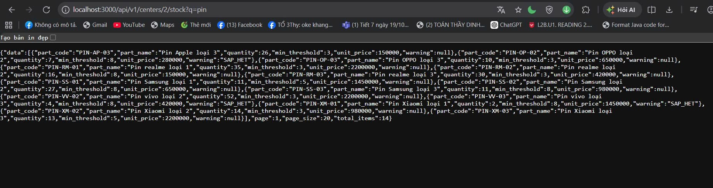
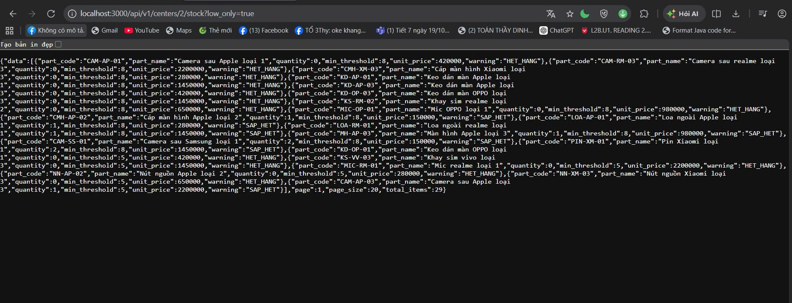
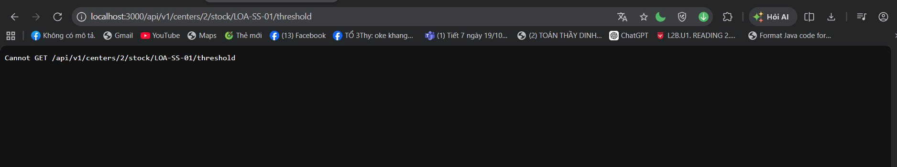

# SmartCRM – Hệ thống quản lý kho phụ tùng

## 1. Giới thiệu dự án

SmartCRM là dự án phục vụ việc quản lý kho phụ tùng thay thế cho trung tâm bảo hành (luồng L5 của hệ thống Smart CRM – Mekong Mobile). Phạm vi nghiệp vụ tập trung vào việc tra cứu tồn kho, xuất kho cho phiếu bảo hành, nhập kho và cảnh báo tồn thấp.

Tài liệu phân tích và thiết kế nằm trong thư mục `docs/`, gồm đặc tả yêu cầu, sơ đồ Use Case, sơ đồ kiến trúc, sơ đồ ERD, wireframe, hợp đồng API và nhật ký thay đổi thiết kế.

## 2. Yêu cầu môi trường

- Node.js 20 LTS trở lên, npm 10 (kiểm tra bằng `node -v` và `npm -v`)
- PostgreSQL 16 (hoặc 14 trở lên), đã tạo CSDL tên `smartcrm`
- Thư viện backend (cài bằng `npm install`): `express`, `pg`, `dotenv`, `csv-parse`
- Biến môi trường: xem `.env.example` (`DB_HOST`, `DB_PORT`, `DB_NAME`, `DB_USER`, `DB_PASSWORD`, `APP_PORT`, `SECRET_KEY`)
- Dữ liệu mẫu: 3 file CSV của dataset (`service_centers.csv`, `parts.csv`, `part_stock.csv`) đặt trong thư mục `data/` ở gốc repo
- Hệ điều hành đã chạy thử: Windows, terminal PowerShell (gọi API bằng `curl.exe`)

## 3. Cài đặt và chạy backend

Mở terminal tại thư mục gốc của dự án.

**Bước 1. Cài thư viện**

```powershell
cd src/backend
npm install
```

**Bước 2. Cấu hình môi trường**

Tạo `.env` ở thư mục gốc từ file mẫu rồi điền `DB_USER`, `DB_PASSWORD` thật. Không commit `.env`.

```powershell
cd ../..
Copy-Item .env.example .env
```

**Bước 3. Tạo CSDL** (một lần)

```sql
CREATE DATABASE smartcrm;
```

**Bước 4. Tạo bảng và nạp dữ liệu danh mục**

```powershell
cd src/backend
npm run migrate
npm run seed
```

Kết quả đúng của `npm run seed`: `service_center: 6`, `part: 180`, `part_stock: 717` dòng. Hai lệnh này chạy lại được.

**Bước 5. Chạy server**

```powershell
npm start
```

Server chạy tại `http://localhost:3000` (đổi bằng `APP_PORT`).

**Gọi thử API** (mở terminal thứ hai):

```powershell
curl.exe "http://localhost:3000/api/v1/centers/2/stock?q=pin"
curl.exe "http://localhost:3000/api/v1/centers/2/stock?low_only=true"
curl.exe -X PATCH "http://localhost:3000/api/v1/centers/2/stock/LOA-SS-01/threshold" -H "Content-Type: application/json" -d "{\"min_threshold\":10}"
```

Đặc tả đầy đủ nằm trong [`docs/api-contract.md`](docs/api-contract.md). Ảnh kết quả chạy lưu trong `docs/screenshots/`.

### Kết quả chạy thử (buổi 8)

**1. Tra cứu tồn kho: tìm "pin" ở trung tâm 2 (14 linh kiện)**



**2. Đặt ngưỡng cảnh báo hợp lệ (200; tồn 8 < ngưỡng 10 nên có cảnh báo SẮP HẾT)**



**3. Đặt ngưỡng sai (−1): 400 VALIDATION_FAILED**



## 4. Cấu trúc thư mục

```text
smartcrm-2374802010543-spare-parts-warehouse/
├── data/                        # Dataset (CSV) dùng để nạp danh mục
├── docs/
│   ├── export/                  # Hình xuất từ các sơ đồ
│   ├── screenshots/             # Ảnh kết quả chạy buổi 8
│   ├── ai-disclosure.md
│   ├── api-contract.md
│   ├── architecture.drawio
│   ├── erd.drawio
│   ├── srs.md
│   ├── thay-doi-thiet-ke.md
│   ├── use-case.drawio
│   └── wireframe.drawio
├── src/
│   ├── backend/
│   │   ├── controllers/         # Lớp 2 – API: nhận/trả JSON, kiểm tra đầu vào, ánh xạ lỗi sang mã HTTP
│   │   ├── services/            # Lớp 3 – Nghiệp vụ: quy tắc QT-09, nhãn cảnh báo tồn thấp
│   │   ├── repositories/        # Lớp 4 – Truy cập dữ liệu: chỉ có SQL
│   │   ├── integrations/        # Khung tích hợp với L2 (hiện thực ở BT2)
│   │   ├── db/                  # Lớp 5 – CSDL: kết nối, migrations, seed
│   │   ├── errors.js
│   │   ├── index.js
│   │   ├── package-lock.json
│   │   └── package.json
│   └── frontend/
├── tests/
├── .env                         # Cấu hình cục bộ; KHÔNG commit
├── .env.example                 # Mẫu cấu hình môi trường
├── .gitignore
├── BT1_2374802010543_TranHuynhMinhTuan.pdf
└── README.md
```

Quy ước kiến trúc: lớp trên chỉ gọi lớp ngay dưới (controller → service → repository → CSDL), khớp Hình 3.1 trong báo cáo BT1.

## 5. Tài liệu liên quan

| Nội dung | Tệp |
|---|---|
| Đặc tả yêu cầu phần mềm | [`docs/srs.md`](docs/srs.md) |
| Sơ đồ kiến trúc | [`docs/architecture.drawio`](docs/architecture.drawio) |
| Sơ đồ ERD | [`docs/erd.drawio`](docs/erd.drawio) |
| Sơ đồ Use Case | [`docs/use-case.drawio`](docs/use-case.drawio) |
| Wireframe | [`docs/wireframe.drawio`](docs/wireframe.drawio) |
| Hợp đồng API | [`docs/api-contract.md`](docs/api-contract.md) |
| Nhật ký thay đổi thiết kế | [`docs/thay-doi-thiet-ke.md`](docs/thay-doi-thiet-ke.md) |
| Khai báo sử dụng công cụ AI | [`docs/ai-disclosure.md`](docs/ai-disclosure.md) |
| Hình ảnh sơ đồ đã xuất | [`docs/export/`](docs/export/) |

## 6. Trạng thái hiện tại (buổi 8)

- [x] Dựng cấu trúc `src/backend/` theo 5 lớp của sơ đồ kiến trúc
- [x] Migration 001–002 theo DDL BT1 (6 bảng, có chỉ mục)
- [x] Seed danh mục: 6 trung tâm, 180 linh kiện, 717 dòng tồn
- [x] EP1 `GET /api/v1/centers/{center_id}/stock` (tra cứu, lọc sắp hết, phân trang 20 dòng, nhãn cảnh báo)
- [x] EP6 `PATCH /api/v1/centers/{center_id}/stock/{part_code}/threshold` (đặt ngưỡng, sai trả 400 `VALIDATION_FAILED`, không có dòng tồn trả 404 `NOT_FOUND`)
- [x] Đã chụp ảnh kết quả chạy trong `docs/screenshots/` (xem mục 3)
- [ ] EP2 xuất kho, EP3 nhập kho, EP4 danh sách sắp hết: làm ở BT2
- [ ] Xác thực và phân quyền (401/403), mã lỗi 409 và 422: làm ở BT2
- [ ] Chưa có unit test: viết ở phần tự học; test NFR3 (xuất đồng thời) và NFR5 (403) làm cùng UC2 ở BT2
- [ ] Frontend: chưa làm
- Ghi chú: EP1 và EP6 hiện chưa kiểm tra token và vai trò, `center_id` lấy từ đường dẫn. Các thay đổi thiết kế sau phản hồi BT1 ghi trong `docs/thay-doi-thiet-ke.md`.

## 7. Phụ lục – Khai báo sử dụng công cụ AI

### 7.1. Công cụ AI được sử dụng

| Công cụ AI | Dùng cho phần nào | Áp dụng ở phần nào | Em đã kiểm chứng / chỉnh sửa gì |
|---|---|---|---|
| Claude | Mục 1: Gợi ý bảng thuật ngữ, yêu cầu chức năng, yêu cầu phi chức năng, các bên liên quan, bảng quy tắc nghiệp vụ và kiểm tra mức độ đầy đủ của bảng truy vết yêu cầu. | Mục 1.1, 1.2, 1.3, 1.4, 1.5, 1.6 | Tôi đã đối chiếu bảng thuật ngữ với file gốc, tài liệu tự học buổi 3 và lý thuyết buổi 3. Tôi kiểm tra các yêu cầu chức năng và phi chức năng có phù hợp với đề bài hay không, sau đó sửa các phần chưa đúng yêu cầu. |
| Claude | Mục 2: Tham khảo gợi ý sơ đồ Use Case và cách trình bày bảng đặc tả UC2, UC6. | Mục 2.1, 2.2 | Tôi đã đối chiếu với file gốc, tài liệu tự học buổi 4 và lý thuyết buổi 4; sửa các phần chưa đúng yêu cầu. |
| Claude | Mục 3: Gợi ý thiết kế kiến trúc và lập luận kiến trúc. | Mục 3 | Tôi đã đối chiếu với file gốc, tài liệu lý thuyết buổi 5 và tài liệu tự học buổi 5; sửa các phần chưa đúng yêu cầu. |
| Claude | Mục 4: Gợi ý sơ đồ ERD và trình bày phần SQL DDL. | Mục 4.1, 4.2 | Tôi đã đối chiếu với file gốc, tài liệu lý thuyết buổi 5 và tài liệu tự học buổi 5; sửa các phần chưa đúng yêu cầu. |
| Claude | Mục 5: Gợi ý wireframe 3 màn hình và đối chiếu các trường trên wireframe. | Mục 5.1 | Tôi đã đối chiếu với file gốc, tài liệu lý thuyết buổi 5 và tài liệu tự học buổi 5; sửa các phần chưa đúng yêu cầu đề bài. |
| Claude | Buổi 8: Gợi ý khung `src/backend/` theo 5 lớp, migration, seed, mã nguồn EP1 và EP6, soạn nhật ký thay đổi thiết kế. | `src/backend/`, `docs/thay-doi-thiet-ke.md`, `docs/api-contract.md` | Tôi đã tự chạy migration, seed và gọi thử API trên máy, đối chiếu số liệu với dataset và hợp đồng API, đọc hiểu từng lớp trước khi commit. |

### 7.2. Các phần tự thực hiện, không sử dụng AI

| Công cụ AI | Công việc | Áp dụng ở phần nào | Kiểm chứng / chỉnh sửa |
|---|---|---|---|
| Không dùng | Tự đánh giá MoSCoW cho các Use Case. | Mục 1.2 – Các bên liên quan | Không áp dụng. |
| Không dùng | Tự vẽ sơ đồ Use Case. | Mục 2 | Không áp dụng. |
| Không dùng | Tự vẽ kiến trúc phân lớp của luồng L5. | Mục 3 | Không áp dụng. |
| Không dùng | Tự vẽ wireframe. | Mục 5 | Không áp dụng. |
| Không dùng | Tự vẽ sơ đồ ERD. | Mục 4.1 | Không áp dụng. |
| Không dùng | Tạo CSDL, cấu hình `.env`, chạy thử và chụp ảnh kết quả. | Buổi 8 | Không áp dụng. |
