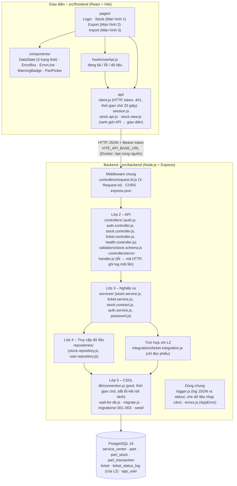
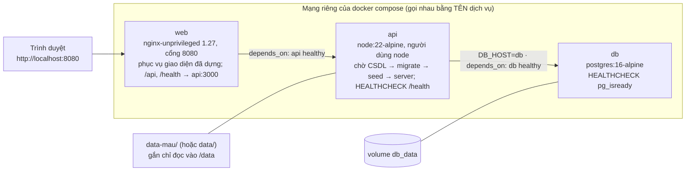

# Kiến trúc đã hiện thực (Bài tập 2)

Sơ đồ dưới đây vẽ các thành phần đang CÓ trong mã nguồn (cập nhật buổi 11), không phải sơ đồ dự kiến của BT1 (`docs/export/architecture.png`). Khác biệt so với BT1 ghi ở `docs/thay-doi-thiet-ke.md`.

## 1. Thành phần trong mã nguồn

`logger.js` được error-handler, request-id, connection, wait-for-db, migrate và seed dùng; không vẽ mũi tên để sơ đồ dễ đọc.

## 2. Triển khai bằng Docker (buổi 11)

Thứ tự khởi động: `db` healthy → `api` healthy → `web`. Cấu hình lấy từ `.env` (mẫu ở `.env.example`). Chạy bằng hai lệnh: `cp .env.example .env` và `docker compose up -d --build` (README mục 3.1).

## 3. Lớp nằm ở đâu

| Lớp | Thư mục | Được gọi bởi | Không được làm |
|---|---|---|---|
| Giao diện | `src/frontend/src/pages`, `components`, `hooks` | Người dùng | Gọi `fetch` trực tiếp (mọi lệnh gọi qua `src/api/`); đọc tên trường snake_case của API (qua `stock.view.js`) |
| Lớp 2 – API | `src/backend/controllers`, `validators` | Giao diện | Chứa quy tắc nghiệp vụ; gọi repository |
| Lớp 3 – Nghiệp vụ | `src/backend/services` | Lớp 2 | Dùng `req`, `res`, mã HTTP; viết SQL; tự ghi log rồi ném lại lỗi |
| Tích hợp L2 | `src/backend/integrations` | Lớp 3 | Sửa phiếu của L2 |
| Lớp 4 – Dữ liệu | `src/backend/repositories` | Lớp 3 | Chứa quy tắc nghiệp vụ; nuốt lỗi CSDL |
| Lớp 5 – CSDL | `src/backend/db` | Lớp 4, tích hợp | — |

## 4. Luồng chính đã ghép (UC2 – xuất linh kiện)

Giao diện `ExportPage` → `stockApi.exportPart` → `POST /api/v1/centers/{id}/stock/exports` → `request-id.js` (gắn requestId) → `auth.js` (401/403) → `stock.schema.js` (400) → `stock.service.exportPart` → `ticket.integration.findTicket` (404/403/422) → `stock.repository.lockStock` (khoá dòng tồn, 404/409) → `changeQuantity` + `insertTransaction` trong một giao dịch CSDL → `stock.contract.toMovementResult` → 201 → `stock.view.toMovementView` → thông báo kết quả kèm nhãn cảnh báo. Kết thúc yêu cầu, `request-id.js` ghi một dòng log JSON (đường dẫn, mã trạng thái, thời gian).

## 5. Lỗi đi qua các lớp thế nào (buổi 11)

| Tình huống | Lớp sinh lỗi | Error-handler trả | Log | Giao diện hiện |
|---|---|---|---|---|
| Vi phạm quy tắc (tồn không đủ, phiếu sai trạng thái) | Lớp 3 ném `AppError` có mã | 409 / 422 theo `error.code` | INFO, có requestId | Câu báo lỗi kèm bước tiếp theo |
| Dữ liệu sai, chưa đăng nhập, sai quyền | Lớp 2 (`stock.schema.js`, `auth.js`) | 400 / 401 / 403 | INFO | Lỗi theo trường; 401 thì về trang đăng nhập |
| Mất CSDL (tắt, khởi động lại, quá `DB_CONNECT_TIMEOUT_MS`) | `pg` ở Lớp 5, không lớp nào bắt | 503 `INTERNAL_ERROR` + mã tra cứu | ERROR, có requestId | Lỗi có mã tra cứu và nút Thử lại |
| Lỗi không lường trước | Bất kỳ | 500 `INTERNAL_ERROR` + mã tra cứu | ERROR kèm stack | Như trên |
| CSDL cắt kết nối đang rảnh | Pool `pg` | Không có yêu cầu nào bị ảnh hưởng | WARN | Không thấy gì; API không sập (BUG-002) |
